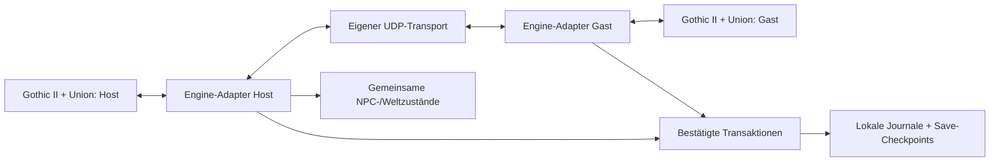

# ZWEIKLANG COOP

**Gothic II: Die Nacht des Raben gemeinsam zu zweit erleben – mit eigenem Charakter auf jedem PC.**


Zweiklang COOP ist eine eigenständige Union-Erweiterung für **Zwei-Spieler-Koop über ein Netzwerk**. Ein PC übernimmt die Hostrolle, der andere verbindet sich als Gast. Beide spielen mit eigener Gothic-Installation und eigener normaler Spielansicht. Der Host verwaltet die gemeinsamen Weltzustände.

> **Stand vom 7. November 2026: Entwickler-Alpha, keine freigegebene gemeinsame Kampagne.**
> Aktuell ist `0.1.0-alpha.26`, Netzwerkprotokoll **9**, Journalformat **4**, Save-Checkpointformat **2**. **2.196 technische Assertions** bestehen; die letzte dokumentierte gemeinsame Spielbestätigung betrifft ausgewählte Funktionen der Alpha.15. Neuere Systeme benötigen weiterhin gemeinsame Spieltests.

**Wichtig für die Einrichtung:** Diese Alpha setzt beim Sitzungsstart ausdrücklich die Koop-Brücken für **Sprint 2.4.0 und Quickloot 1.9.5** voraus. Die unveränderten Originalarchive allein reichen nicht. Fremdarchive, SDK, Union-Laufzeit und Originalspiele sind **nicht enthalten**. Es gibt kein über GitHub veröffentlichtes Fertig-Release; der dokumentierte Weg führt über den eigenen Build und separat beschaffte Abhängigkeiten.

[Installation](INSTALLATION.md) · [Selbst kompilieren](BUILDING.md) · [Roadmap](ROADMAP.md) · [Versionshistorie](CHANGELOG.md) · [Architektur](docs/ARCHITECTURE.md) · [Testplan](docs/TESTPLAN-CAVALORN.md) · [Mitwirken](CONTRIBUTING.md)

## Was ist Zweiklang COOP?

Gothic II ist ursprünglich ein Einzelspielerspiel. Zweiklang soll es ermöglichen, mit einer zweiten Person durch dieselbe Welt zu ziehen, gemeinsam Gegner zu bekämpfen, Beutequellen zu nutzen und später eine zusammenhängende Kampagne zu erleben. Beide Figuren sollen sich unabhängig entwickeln können; gemeinsame Welt- und Questzustände müssen dabei konsistent bleiben.

Die Mod ist kein Splitscreen und kein lokaler Zwei-Controller-Modus. Sie ersetzt weder das normale Kamerasystem noch die normale Einzelspielersteuerung durch eine gemeinsame Kamera. Stattdessen verbindet ein eigener UDP-Netzwerkkern zwei laufende Spielinstanzen. Die bisher dokumentierten Spieltests betreffen ein LAN. Internetbetrieb mit NAT, öffentliche Server, automatische Vermittlung und eine dedizierte Serverumgebung sind nicht als fertige Funktionen nachgewiesen.

Der Netzwerkkern, die Protokolle und die eigenen Engine-Adapter wurden für Zweiklang geschrieben. Zum Kompilieren werden externe Union-/ZenGin-SDK-Definitionen aus einem separat beschafften Referenzstand verwendet. Die fremde Koop-Spielimplementierung wird nicht als eigener Zweiklang-Code mitgeliefert oder in das Plugin eingebunden.

## Funktionsübersicht

Die Angaben beziehen sich auf den **belegten Umfang**, nicht auf eine pauschale Aussage zur Durchspielbarkeit:

- **Implementiert:** der beschriebene Umfang ist technisch oder durch den angegebenen Spieltest nachgewiesen.
- **Teilweise implementiert:** Code und technische Prüfungen existieren, aber wesentliche Sonderfälle oder native Abnahmen fehlen.
- **Geplant:** noch nicht allgemein umgesetzt.
- **Unbekannt:** anhand der vorliegenden Nachweise nicht zugesichert.

| Funktion | Entwicklungsstand | Nachweis und Grenze |
|---|---|---|
| Zwei-Spieler-LAN-Verbindung | Implementiert; Regression offen | Host/Gast, Beitritt und Reconnect wurden im Spiel bestätigt. Die aktuelle Kombination erneut testen. |
| Union-Einstellungen | Implementiert | Name, Host-/Client-IP, Port, Rolle, Figur, Logging und Friendly Fire; Texteingabe und deutsches Layout wurden bestätigt. |
| Partnerfigur und Gesichter | Implementiert; Regression offen | Namenloser Held und Velaya-Darstellung aus vorhandenen G2-Ressourcen; korrigierte Gesichter und Bewegungsanimationen wurden bestätigt. |
| Bewegung, Gasttreffer und Aggro | Implementiert im getesteten Umfang | Alpha.15: Bewegung ohne Reconnect, Gastschaden, Gegnerverfolgung und gleiche Gegner-HP bestätigt. |
| Gemeinsame NPC-/Kampfzustände | Teilweise implementiert | Host-Autorität, eigene Spieler-HP, Trefferereignisse; Tod, Bewusstlosigkeit, Fernkampf, Magie und Sonderfälle noch umfassend abnehmen. |
| Friendly Fire und Partnerfokus | Teilweise implementiert | Hostregel und Schadensschutz eingebaut. Bei FF aus ist der Partner nur mit weggesteckter Waffe im sozialen Fokus; neuerer Spieltest offen. |
| Leichen und Kisten | Teilweise implementiert | Entnehmen, Einlagern, Quellen-Sperren und Schlosszustände eingebaut; gemeinsame native Abnahme offen. |
| Bodenitems und NPC-Handel | Teilweise implementiert | Bestands-/Goldabgleich und bestätigte Transaktionen für gewöhnliche Items; Sonderzustände und Spieltests offen. |
| Transfer-Recovery | Teilweise implementiert | Persistente Entscheidungen, Checkpoints und Altformat-Regressionen technisch geprüft; kein allgemeines Zurückspulen beliebiger Saves. |
| Sprint und Quickloot | Teilweise implementiert | Lokale Archivtransformation und native Koop-Brücken vorhanden; Abhängigkeiten separat erforderlich, Kombination im Spiel abnehmen. |
| Cavalorns Banditen | Teilweise implementiert | Enger erster Questadapter: Host führt Dialoge; Gast erhält Quest-/Tagebuchstand und volle tatsächlich gewährte Gaben. Spielabnahme offen. |
| Zwei Aktivierungsgebiete | Teilweise implementiert | Host berücksichtigt beide Spielergebiete innerhalb derselben Welt; große Distanz und Langzeitbetrieb nicht freigegeben. |
| Diagnose und Testmarken | Implementiert, Bedienabnahme offen | Strukturierte Logs, Rotation, Bereitschaft/Sperrgründe und 65 gemeinsame Schrittmarken. Keine vollständige Aufzeichnung jedes internen Spielvorgangs. |
| Allgemeine Quests, Fraktionen und Kampf-EP-Teilung | Geplant | Der Cavalorn-Adapter ist keine allgemeine Questlösung. |
| Gemeinsames Ein-Klick-Speichern / getrennte Welten | Geplant bzw. offen | Aktuell manuelle passende Saves; Weltwechsel beenden die Sitzung. |
| Direkter Spielerhandel, weitere Aussehen, Startausrüstung | Geplant für Beta | Kein Spieler-Handelsfenster in dieser Alpha. |
| Splitscreen, Controllerzuordnung, gemeinsame Kamera | Nicht implementiert | Normale Spielansicht und Eingabe je PC. |
| Andere Spiel-/TC-Versionen, Internet-/NAT-Betrieb | Unbekannt / nicht freigegeben | Keine pauschale Kompatibilitäts- oder Stabilitätszusage. |

## Aktueller Entwicklungsstand

Die aktive Entwicklung konzentriert sich auf Gothic II DNdR und einen belastbaren Koop-Kern. Die kurze gemeinsame Teststrecke beginnt in Xardas’ Turm und endet nach Cavalorns Banditenhöhle. Handel bei einem echten Händler, große Entfernungen und weitere Sonderfälle benötigen gegebenenfalls separate Durchgänge.

Alpha.26 nimmt die Startbild-/Transparenzexperimente aus Alpha.24/25 zurück. Der Menücode entspricht wieder der Basis vor dem Grafikeinbau; das normale Gothic-Menü wird verwendet. Das eigene Startbild ist eine **Beta-Aufgabe**. Der Rückbau verändert nicht die übrigen Koop-Funktionen, die Netzwerkversion oder die Speicherformate.

Die Prüfungen unterscheiden klar zwischen automatischen Tests und Spielbeobachtung. Ein erfolgreicher Build, ein korrekt dekodiertes Paket oder eine simulierte Recovery-Transaktion beweist noch nicht, dass ein entsprechender Spielablauf auf zwei PCs fehlerfrei funktioniert. Deshalb sind zahlreiche bereits programmierte Systeme weiterhin als teilweise implementiert gekennzeichnet.

## Voraussetzungen

| Bereich | Dokumentiertes Profil |
|---|---|
| Originalspiel | Separat beschafftes Gothic II mit Add-on **Die Nacht des Raben**; untersuchte 32-Bit-`Gothic2.exe` in Version **2.6 (fix)** |
| Laufzeit | **Union 1.0m**, dazu das zugehörige Menüskript `zUnionMenu.d` |
| Betriebssystem | Windows; das Plugin wird als **Win32/x86-DLL** gebaut. Die lokale Entwicklung erfolgte unter Windows 11. Andere Betriebssysteme sind nicht nachgewiesen. |
| Visual-C++-Laufzeit | Zur verwendeten MSVC-Toolchain passende **x86**-Laufzeit; das Projekt verwendet `/MD` |
| QoL-Abhängigkeiten | Ninja **4.1.16**, Toolkit **16.0**, Quickloot **1.9.5**, Sprint **2.4.0**, PatchMenu **1.1.1**; Quickloot/Sprint mit Brückenrevision 1 |
| Netzwerk | Zwei kompatible Installationen, dieselbe geladene Welt, erreichbare Host-IPv4 und gleicher UDP-Port; Standard **12345** |
| Optionaler Renderer | GD3D11 **17.9.7** im dokumentierten lokalen Testprofil; nicht Bestandteil des Plugins |
| Entwicklung | MSVC **v142**, Windows-10-SDK, MSBuild, C++17; externe Union-/ZenGin-SDK-Abhängigkeit; Python 3 für Hilfswerkzeuge |

**Beide Originalspielinstallationen und sämtliche fremden Laufzeitkomponenten müssen separat und rechtmäßig beschafft werden.** Dieses Repository enthält keine Spiel-EXE, keine Spielarchive, keine Texturen, Modelle, Animationen, Sounds, Musik oder Website-Dateien. Auch fremde Modarchive und SDK-Binärdateien werden nicht mitgeliefert. Einzelheiten: [Abhängigkeiten](docs/DEPENDENCIES.md), [Drittanbieterhinweise](THIRD_PARTY.md).

## Installation

Der vollständige Ablauf steht in [INSTALLATION.md](INSTALLATION.md). Kurzfassung:

1. Zwei passende G2-DNdR-/Union-Installationen vorbereiten und sichern. Für diese Alpha gesicherte Testspielstände verwenden.
2. Den Quellstand aus diesem Repository beziehen und das Plugin nach [BUILDING.md](BUILDING.md) bauen. Ein öffentliches Fertig-Release wird hier nicht behauptet.
3. Die fünf erforderlichen QoL-Originaldateien separat beschaffen. Mit `scripts/Prepare-QolCompatibility.py` lokale kompatible Archive erzeugen; fremde Originale bleiben unverändert.
4. Das vorhandene Union-Menüskript separat bereitstellen. `scripts/Install-Alpha.ps1` kopiert die eigene DLL, die beiden eigenen Autorun-Skripte und die lokal vorbereiteten QoL-Dateien in die gewählte Installation und berechnet deren Inhaltskennung.
5. Ninja über die Union-Pluginliste laden lassen und die QoL-Voreinstellungen mit `scripts/Configure-Qol.py` ergänzen. Vorhandene Grafik-/Tasteneinstellungen werden von diesem Hilfswerkzeug nicht ersetzt.
6. Auf beiden PCs dieselben Inhalte installieren. Eigene Namen, Rolle, lokale Adressen und Hostadresse im Union-Menü konfigurieren.
7. Gothic normal starten, passende Welt laden, Host-Sitzung starten und Gast verbinden. Erst bei vollständiger Bereitschaft testen; `Connected` allein ist noch kein vollständiger Abgleich.

Der Installer unterstützt `-WhatIf`. Vorhandene persönliche Pluginoptionen werden bei einem Update erhalten; übergebene Rollen-/Namensparameter dienen der **Ersteinrichtung**. Backups betreffen Runtime-Dateien. Ein Rückbau älterer Pluginversionen darf nicht mit unpassenden Save-/Recovery-Daten kombiniert werden.

## Verwendung

**Einstellungen → Union & Plugins → Zweiklang Coop** öffnet das native Pluginmenü. Je nach Union-Sprachfassung kann die übergeordnete Bezeichnung leicht abweichen. Dort lassen sich Name, Host-IP, Client-IP, Port, Rolle, Figur, Logging und Friendly Fire einstellen. Texteingaben mit Enter bearbeiten/bestätigen; Escape verwirft die laufende Eingabe.

- **F6:** Host-Sitzung starten.
- **F7:** Als Gast verbinden.
- **F8:** Sitzung trennen.
- **Strg + Umschalt + D:** Diagnoseanzeige umschalten.
- **Strg + Umschalt + N/B:** nächsten/vorigen Testschritt wählen.
- **Strg + Umschalt + M:** gemeinsame Logmarkierung für den gewählten Schritt schreiben.

Die **Host-IP** bezeichnet die Adresse des Host-PCs. Das **Client-IP-Feld** ist die lokale Bindeadresse des Gast-PCs, keine zweite Hostadresse. Die Rollenwahl kann die passende primäre lokale IPv4 anzeigen; die entfernte Hostadresse muss auf dem Gast trotzdem stimmen.

Quickloot verwendet im dokumentierten Profil die rechte Maustaste bei weggesteckter Waffe. Verschlossene oder skriptgesteuerte Kisten regulär bedienen. Gebundene/ausgerüstete Items und NPC-Rüstungen sind nicht allgemein für den Schnellpfad freigegeben. Während einer Trennung keine unkoordinierten Inventaränderungen vornehmen.

Jeder Spieler behält seinen eigenen erlittenen Schaden. Gemeinsame Gegner sollen auf beiden PCs denselben Zustand haben. Beim ersten Questadapter führt der Host die Cavalorn-Dialoge. Jeder erhält die vollen tatsächlich gewährten Gaben: je 100 Abschluss-EP, gegebenenfalls je 50 Gold und bei regulärer Ausrüstung je ein Messer/zwei Heiltränke. Diese bedingten Originalgaben werden nicht erfunden, wenn der Hostdialog sie nicht vergibt.

**Speichern, Laden und Weltwechsel trennen die Sitzung absichtlich.** Beide speichern separat in passenden Slots, anschließend Host neu starten, Gast verbinden und Bereitschaft abwarten. Es gibt noch keinen gemeinsamen Ein-Klick-Save und kein sicheres beliebiges Zurückspringen auf alte Einzelspielersaves.

## Projektarchitektur



| Bereich | Verantwortung |
|---|---|
| `src/ZweiklangCoop/src/Network.cpp` | Nicht blockierender Winsock-Transport, Sitzungen, ACK/Wiederholung, begrenzte Warteschlangen |
| `include/coop/*Protocol.h` | Begrenzte Nachrichtenformate und Validierung für Kampf, Welt, Loot und Sitzung |
| `src/Plugin.cpp`, `UnionEntry.cpp` | Einbindung in Union/Gothic, Menü-/Tastaturbehandlung und Lebenszyklus |
| `*Bridge.inl` | Native Adapter für Kampf, Loot, Welt, Recovery, Diagnosebereitschaft, QoL und Cavalorn |
| `include/coop/Recovery.h` | Persistente Transaktionsentscheidungen und versionierte Checkpoints |
| `scripts/*.d` im eigenen Quellprojekt | Eigene Partnerinstanz, schmale Spielhelfer und Union-Menüeinträge |
| `tests/` im eigenen Quellprojekt | UDP-/Codec-/Recovery-/Eingabe-/Diagnose- und Kompatibilitätsprüfungen |
| Repository-`scripts/` | Portable Build-, lokale Abhängigkeits-, Installations- und Publikationswerkzeuge |

Enginezugriffe erfolgen im Spielthread; es wird kein separater Gothic-Serverprozess erzeugt. Die Hostautorität und lokal persistierte Entscheidungen ersetzen keine vollständige gemeinsame Save-Datei. Mehr dazu in [docs/ARCHITECTURE.md](docs/ARCHITECTURE.md).

## Selbst kompilieren

```powershell
# Ohne Gothic-SDK: eigenständige technische Tests bauen und ausführen
.\scripts\Build-Alpha.ps1 -TestsOnly

# Plugin und Tests mit separat vorhandenem Union-/ZenGin-SDK
.\scripts\Build-Alpha.ps1 -SdkRoot .\local\sdk\GothicCoop
```

Die SDK-Referenz ist in [config/dependencies.json](config/dependencies.json) mit einem konkreten Commit dokumentiert. Das SDK wird nicht automatisch heruntergeladen und nicht veröffentlicht. `SdkRoot` kann auf einen anderen vorhandenen Checkout zeigen. Ausgabe: `build/alpha/G2NotR/ZweiklangCoop.dll`; Testprogramm: `build/alpha/tests/ZweiklangNetworkTests.exe`. Details und direkte MSBuild-Befehle: [BUILDING.md](BUILDING.md).

## Roadmap

- **Abgeschlossen im dokumentierten Umfang:** eigenständige Modbasis, Union-Konfiguration, deutsche Texteingabe, grundlegende Partnerdarstellung sowie die bestätigten Verbindungs-/Bewegungs-/Kampfabläufe.
- **Aktuell:** den erweiterten Koop-Kern auf zwei PCs abnehmen und nach Befund korrigieren; anschließend offene grundlegende Quest-, Welt-, Save- und Fortschrittssysteme vervollständigen.
- **Beta:** längere Kampagnentests, Stabilitäts-/Leistungsmessungen, direkter Spielerhandel, je zwei männliche/weibliche Aussehen, Startausrüstung und erneute Untersuchung des eigenen Startbilds.
- **Vollversion:** ausschließlich die geprüfte Gothic-II-DNdR-Basis mit dokumentierten Voraussetzungen, Kampagnen-/Speicherabnahme und sicherem Installationsweg freigeben.
- **Eigene spätere Versionen:** **Odyssee-Erweiterung** und **Gothic-1-Portierung** erhalten getrennte Adapter, Installationen, Tests und Freigaben. Sie sind keine Voraussetzungen der Gothic-2-Vollversion.
- **Optionale Idee:** weibliche Spielerdialoge; Umfang und Umsetzung sind nicht beschlossen.

Die [Roadmap](ROADMAP.md) trennt Arbeitspakete und Abschlusskriterien. Sie enthält keine Termin- oder pauschale Kompatibilitätszusage.

## Bekannte Probleme und Einschränkungen

1. Keine nachgewiesene vollständige gemeinsame Kampagne. Aktuelle Spielabnahme bis Cavalorn offen.
2. Allgemeine Quests, freie Questabgabe durch den Gast, Fraktionsausnahmen und allgemeine Kampf-EP-Teilung fehlen noch. Der Cavalorn-Adapter deckt nur das untersuchte Skriptprofil ab.
3. Speichern/Laden trennt die Sitzung; lokale Saves und Recovery-Zustände müssen zusammenpassen. Bereits protokollierte Belohnungen sind kein beliebig rückspulbarer Weltzustand.
4. Gewöhnliche Gegenstände werden unterstützt; spezielle Itemdaten, Diebstahl-/Skriptfolgen und Weltobjektzustände sind nicht allgemein synchronisiert.
5. Unterschiedliche Welten/Weltwechsel sind nicht als laufender unabhängiger Koop freigegeben. Große Entfernung und lange getrennte Wege benötigen weitere Tests.
6. Die originale Engine und weitere Plugins können native Interaktionen verändern. Nur die dokumentierte Kombination wird untersucht; gleiche Dateiversionen auf beiden PCs sind erforderlich.
7. Das eigene Startbild und die transparente Hauptmenüvariante sind nach Darstellungsfehlern zurückgezogen. **Alpha.26 verwendet das Originalmenü.**
8. Die Alpha lehnt den Sitzungsstart ab, wenn die benötigten Quickloot-/Sprint-Brückenmarker fehlen. Nicht durch Entfernen der Prüfungen umgehen; Abhängigkeiten korrekt vorbereiten.

Fehler bitte mit reproduzierbaren Schritten, Build, betroffener Rolle, Uhrzeit und relevanten bereinigten Logs melden. Keine Originalspiele, vollständigen Spielstände oder privaten Diagnosearchive öffentlich hochladen.

## Mitwirken

[Issues](https://github.com/Horst-Adler/Zweiklang-COOP/issues) dienen nachvollziehbaren Fehlerberichten und Vorschlägen. [Pull Requests](https://github.com/Horst-Adler/Zweiklang-COOP/pulls) sollen einen klaren, begrenzten Zweck und passende Nachweise haben. Besonders hilfreich sind reproduzierbare Zwei-PC-Tests, Recovery-/Duplikatfälle, native ABI-Prüfungen und dokumentierte Kompatibilitätsbefunde. Leitfaden: [CONTRIBUTING.md](CONTRIBUTING.md).

## Lizenz und rechtliche Hinweise

Der eigenständige Zweiklang-Code steht bereits unter **AGPL-3.0-only**; der vorhandene Lizenztext wird unverändert in [LICENSE](LICENSE) übernommen. Externe SDKs, Laufzeiten und Mods behalten ihre eigenen Rechte und werden dadurch nicht neu lizenziert.

Zweiklang ist ein eigenständiges Fan-/Community-Projekt. Gothic und die Originalspielinhalte gehören den jeweiligen Rechteinhabern. **Dieses Repository enthält keine Originalspiel-Dateien und keine private Projektwebsite.** Fremde Spiel-/Modressourcen werden nicht zur Vereinfachung der Installation hochgeladen. Die vier kleinen BIN-Dateien im Testverzeichnis sind ausdrücklich synthetische Eingaben des eigenen Recovery-Serializers, keine Spielstände.

[THIRD_PARTY.md](THIRD_PARTY.md) dokumentiert die externen Bestandteile. [docs/PUBLICATION.md](docs/PUBLICATION.md) erklärt die Positivliste und die zusätzlichen Prüfungen vor einem Commit.

## Changelog und Versionshistorie

Die [Versionshistorie](CHANGELOG.md) führt belegte Alpha-Stände bis **Alpha.26** auf. Eine GitHub-Veröffentlichung dieses Quellstands ist keine nachträgliche Behauptung, alle historischen Funktionen seien im Spiel abgenommen. Es wird allein aus der Entwicklungsnummer kein öffentlicher Release erzeugt.
